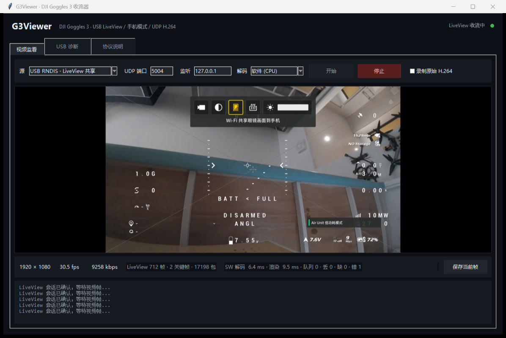

<div align="center">
  
  <h1>G3Viewer</h1>
  <p><strong>DJI Goggles 3 USB LiveView 接收器</strong><br>
  在 Windows 上直接观看眼镜画面 · 低延迟 · 不拆机 · 不需要 Cynthion / 手机 / 眼镜 Wi-Fi</p>
</div>

<p align="center">
  
  
  
  
</p>

> **English** — G3Viewer receives DJI Goggles 3 LiveView over USB RNDIS, reassembles the H.264 stream, and displays it with low latency. It is a ready-to-run Windows app with USB diagnostics, recording, RTSP output, and UDP/file fallback sources.

---

## 这个项目是做什么的

**一句话：把 DJI Goggles 3 的 USB LiveView 画面，变成 Windows 上可显示、可录制、可转发的视频流。**

G3Viewer 是一个 Windows 桌面端接收器。用一根 USB-C 数据线把 Goggles 3 接到电脑，打开眼镜的 LiveView 共享，程序就能在 PC 上显示眼镜正在看的画面，并支持录制、截图和 RTSP 转发。它不拆机、不需要 Cynthion、不需要手机，也不需要把电脑连到眼镜 Wi-Fi。

### 典型用途

- 在 PC 大屏上查看 Goggles 3 的实时画面；
- 录制原始 H.264 素材、保存关键帧；
- 通过 RTSP 把画面交给 FFmpeg、VLC 等工具；
- 做 USB/协议诊断，确认眼镜当前处于哪种 USB 模式；
- 没有眼镜时，用 UDP 或本地文件测试解码链路。

### 它不是什么

- 不是 UVC 摄像头驱动，不会把眼镜变成普通摄像头；
- 不是硬件改装，不需要拆机、Cynthion 或手机；
- 不包含 DJI 固件、签名密钥或破解授权代码；
- 不是 Mission Planner 插件；RTSP 只是提供给外部播放器/地面站使用。

## 为什么需要它

Goggles 3 插上 PC 后，普通播放器看不到画面，不是线坏了，也不是驱动没装，而是眼镜的 **PC/OTG 模式根本没有暴露 UVC 摄像头**。设备管理器里只能看到：

```text
2CA3:0020  rndis,mass_storage,bulk,acm
MI00 RNDIS / MI01 RNDIS 数据 / MI02 U 盘
MI03–MI07  5 个厂商 Bulk 接口
MI04       每秒 77 字节 DUML 心跳：40 00 81 "ZV902" ...
```

天空端只让眼镜屏幕有画面，不会主动把视频推到 Bulk 端点。真正的视频在另一个开关后面：**LiveView 共享 / 实时画面共享**。打开后，视频走 **USB RNDIS 网卡上的 UDP**：

```text
PC RNDIS 网卡：192.168.60.1/24
眼镜：         192.168.60.2:9003
本地 UDP：     12346
```

这套私有 UDP 协议需要专用握手、分片重组和解码，普通播放器、OBS、Mission Planner 都无法直接打开。G3Viewer 把这段链路完整实现，用户不需要研究协议，也不需要额外硬件。

## 它怎么工作

```text
Goggles 3
   │ USB-C（2CA3:0020）
   ▼
RNDIS 192.168.60.1/24
   │ UDP 192.168.60.2:9003 → 本机 12346
   ▼
LiveProtocol
  48 字节握手 / session+XOR / part-count 重组 / 30 字节 ACK
   │
   ▼
H.264 码流
   ├── PyAV 解码 ──► Tkinter 窗口
   └── RTSP :8554 ──► FFmpeg / VLC（可选）
```

G3Viewer 实现的关键环节：

- 48 字节 LiveView 握手、session/XOR、每秒重发；
- UDP 分片重组、part/count 解码、30 字节 ACK；
- Annex B H.264 低延迟解码；
- Tkinter 实时显示、录制、截图和链路统计；
- 可选 RTSP 输出，供 FFmpeg/VLC 等播放。

实测：**1920×1080 / 30 fps / 约 10 Mbps**，应用侧解码/渲染约 **5 ms / 10 ms**，端到端约 **0.2 s**（剩余主要是眼镜编码、天空端无线链路和 LiveView 本身）。

## 功能

| 功能 | 说明 |
|---|---|
| USB LiveView | Windows 下直连眼镜，走 RNDIS；不需要 UVC、Cynthion 或手机 |
| 低延迟解码 | PyAV 单线程 + `AV_CODEC_FLAG_LOW_DELAY`；软件解码整帧直喂 |
| 硬件解码 | Windows D3D11VA，走标准 H.264 parser；不可用时自动回退软件 |
| 抗马赛克 | 收包/解码分离，8 MB UDP 缓冲，独立解码队列 |
| 状态统计 | `队列 / 丢 / 缺 / 错`、解码/渲染耗时、帧率、码率、包数 |
| 录制/截图 | 原始 H.264 录制、当前帧 PNG 保存 |
| 可选 RTSP | `rtsp://127.0.0.1:8554/fpv_stream`，供 FFmpeg/VLC 等使用 |
| 其他输入 | UDP 裸 H.264、本地 H.264/MP4、手机/MFI 实验路径 |
| USB 诊断 | 读取 PC/OTG 描述符和 MI04 DUML 心跳，解释为什么没有 UVC |
| 开箱即用 | 仓库内含 `G3Viewer.exe` 和 `_internal` 运行库，解压即可运行 |

## 截图


## 快速开始

### 直接运行

仓库已经包含 Windows 构建，下载或克隆后直接运行：

```text
G3Viewer.exe
```

只做 USB 诊断、不打开窗口：

```powershell
.\G3Viewer.exe --diag
```

### 从源码运行

要求 Python 3.11+ 64 位：

```powershell
python -m venv .venv
.venv\Scripts\activate
pip install -r requirements.txt

python app\main.py --rndis
# 或者启用 D3D11VA
python app\main.py --rndis --hardware
```

### 构建 exe

```powershell
pip install pyinstaller
python -m PyInstaller --noconfirm --clean --windowed --name G3Viewer `
  --paths app --collect-all av --collect-all libusb_package --collect-all usb app\main.py
```

输出在 `dist/G3Viewer/G3Viewer.exe`。

## 连接 Goggles 3

1. 天空端/飞行器开机，眼镜屏幕能看到图传；
2. 眼镜：**设置 → 关于 → OTG 有线连接模式**，打开；
3. 眼镜：按 **5D 键向下**，打开 **LiveView 共享 / 实时画面共享**；
   - 名字里虽然写着 Wi-Fi，但本程序走 USB RNDIS，电脑不用连眼镜 Wi-Fi；
4. 用 USB-C **数据线**连接电脑；
5. 打开 G3Viewer，源选 **USB RNDIS · LiveView 共享**，点 **开始**；
6. 第一次会弹一次 UAC：只给 VID `2CA3:PID 0020` 的 RNDIS 网卡添加
   `192.168.60.1/24`，**不改默认网关、DNS、防火墙**；
7. 程序持续握手，收到 H.264 后出画面。

### 一直黑屏，但日志显示已收到视频

眼镜使用 **intra-refresh**，不保证新会话一开始就有关键帧。保持程序连接，在眼镜上把
**LiveView 共享关掉再打开一次**，让眼镜补发 SPS/PPS + IDR。日志会变成：

```text
LiveView 会话已确认，等待视频帧...
收到 IDR 关键帧，开始解码。
```

### 不要给 RNDIS 装 Zadig

PC/LiveView 模式必须保留微软 RNDIS 驱动。Zadig/WinUSB 只用于手机/MFI 模式
（`2CA3:1002`）的 Interface 1；给 RNDIS 网卡换驱动会让 LiveView 直接不可用。

## 工作原理

```text
DJI Goggles 3
      │ USB-C，VID:PID 2CA3:0020
      ▼
USB RNDIS 网卡  192.168.60.1/24
      │ UDP 192.168.60.2:9003 → 本机 12346
      ▼
LiveProtocol
  握手 / part-count 重组 / ACK
      │
      ▼
H.264 access units
      ├── PyAV 解码 ──────► Tkinter 窗口
      └── RTSP :8554 ─────► FFmpeg / VLC（可选）
```

视频不是 UVC，也不是 Bulk。PC/OTG 模式下的 5 个 Bulk 接口只承载 DUML/厂商数据；打开 LiveView 共享后才会出现 RNDIS UDP 视频。

更完整的描述符、DUML、LiveView、MFI 记录见 **[docs/PROTOCOL.md](docs/PROTOCOL.md)**。

## 视频源

| 源 | 用途 |
|---|---|
| **USB RNDIS · LiveView 共享** | **推荐**，Windows 直连眼镜 |
| **UDP 裸 H.264** | 树莓派、Cosmostreamer 等网络桥；默认监听 `127.0.0.1:5004` |
| **本地 H.264 / MP4 文件** | 回放、验证解码器，不需要眼镜 |
| **手机模式 USB（2CA3:1002）** | Cynthion/树莓派角色切换后的 MFI 路径，实验性 |

局域网 UDP 桥转发时用 `--bind 0.0.0.0`，首次监听会触发 Windows 防火墙询问。

```powershell
# 终端 A：接收
python app\main.py --udp 5004 --bind 0.0.0.0

# 终端 B：本地测试发送
python tools\udp_h264_sender.py captures\synthetic.h264 --loop
```

## RTSP 输出

程序启动后自动提供：

```text
rtsp://127.0.0.1:8554/fpv_stream
```

可用 FFmpeg 验证：

```powershell
ffmpeg -rtsp_transport udp -i rtsp://127.0.0.1:8554/fpv_stream -frames:v 30 -f null -
```

VLC 也可以直接打开该地址。Mission Planner 如果使用 RTSP，需要本机已有可用的
GStreamer；MP 自带的 GStreamer 下载器有时会卡在 “downloading”，这时更建议用
FFmpeg/VLC 验证流本身，或使用后续带 MJPEG 输出的版本。

## 低延迟与稳定性

PyAV 默认 `thread_type=AUTO` 会在首帧前缓存约 17 帧（30 fps 约 530 ms），这是早期
0.8 s 延迟的主要来源。现在：

```python
thread_type = "NONE"
thread_count = 1
flags |= AV_CODEC_FLAG_LOW_DELAY
```

软件解码路径把 LiveView 的完整 access unit 直接交给 `decode(av.Packet(frame))`；
硬件 D3D11VA 路径为了多 slice 兼容性走标准 parser。实测：

```text
解码约 5 ms · 渲染约 10 ms · 1920×1080 / 30 fps / 约 10 Mbps
```

底部四个计数：

| 计数 | 含义 |
|---|---|
| `队列` | 解码队列积压帧数，正常应接近 0 |
| `丢` | 解码队列满导致的丢帧 |
| `缺` | UDP 序号跳变，通常表示网络/分片丢失 |
| `错` | libavcodec 解码错误；启动时可能残留 1–7 次 |

运动时如果 `缺` 持续增长，优先检查 USB 线、USB 口、其他占用 12346 的程序；
如果 `队列/丢` 增长，检查是否同时开了多个实例、录制或其他高 CPU 任务。

## 项目结构

```text
G3Viewer.exe          Windows 预编译主程序
_internal/            PyInstaller 运行库和依赖
app/
  main.py             GUI、RNDIS/LiveView、UDP/文件、录制、RTSP 启动
  rndis_receiver.py   LiveView 握手/组帧/ACK + RNDIS 地址配置
  decoder.py          PyAV H.264 低延迟解码（软件/D3D11VA）
  rtsp_server.py      低延迟 RTSP/RTP H.264 输出（可选）
  mobile_receiver.py  2CA3:1002 0x55CC MFI 路径（实验）
  pc_diag.py          PC/OTG 描述符与 MI04 心跳诊断
tools/                协议测试、解码测试、UDP 发送、USB/DUML 诊断
docs/
  PROTOCOL.md         描述符、DUML、LiveView、MFI 协议笔记
captures/             截图、合成 H.264
requirements.txt      Windows 依赖
run_g3view.bat        源码启动脚本
```

## 常见问题

| 现象 | 处理 |
|---|---|
| 天空端已连，为什么没画面？ | 确认眼镜里 **LiveView 共享**已打开；只开 OTG 不够 |
| UAC 一定要给吗？ | 只有第一次需要，只改 RNDIS 网卡地址；拒绝会停在“RNDIS 配置失败” |
| 能装 Zadig 吗？ | RNDIS 网卡不能；Zadig 只用于手机/MFI 的 `2CA3:1002` Interface 1 |
| LiveView 是 Wi-Fi 共享，电脑要连眼镜 Wi-Fi 吗？ | 不用；程序走 USB RNDIS，Wi-Fi 可保持原样 |
| 一直黑屏但码率非零？ | 保持程序连接，把 LiveView 共享关/开一次，等 IDR |
| 画面卡/等待视频？ | 关闭其他占用眼镜 USB 或 12346 端口的程序；拔插 USB；重开 LiveView |
| 动起来有马赛克？ | 先看 `队列/丢/缺/错`；软件解码是否正常，硬件是否回退；避免多实例 |
| 录制文件在哪？ | 默认 `captures/g3-*.h264`；转 MP4：`ffmpeg -framerate 60 -i ... -c copy out.mp4` |
| 能直接连 Mac 吗？ | 当前仓库是 Windows 构建；macOS 没有原生 RNDIS 驱动，需 UDP 桥接或 Windows 虚拟机 |

## 已知限制

- 主要验证平台是 Windows 10/11；`G3Viewer.exe` 是 Windows 构建。
- 眼镜使用 intra-refresh，连接后可能需要关/开一次 LiveView 才能拿到 IDR。
- 手机/MFI 路径需要 USB 角色切换和额外驱动，属于实验功能。
- Mission Planner 的 RTSP 输入依赖本机 GStreamer；GStreamer 下载/配置问题不属于本程序能修复的范围。
- 本项目不包含 DJI 固件、签名密钥或破解授权代码；只做自己设备上的互操作/协议研究。

## 合规与致谢

本项目仅用于自己设备上的互操作和协议研究。使用前请确认不违反当地法律、DJI 用户协议和保修条款；不要用于规避飞行限制、窃取他人图传或干扰无线电。项目与 DJI 无关联。

LiveView 协议实现参考 MIT 项目：

- [knpuma/goggle-3-liveview](https://github.com/knpuma/goggle-3-liveview)
- [Windows/README.md](https://github.com/knpuma/goggle-3-liveview/blob/main/Windows/README.md)
- [LiveProtocol.cs](https://github.com/knpuma/goggle-3-liveview/blob/main/Windows/Goggles3.Core/LiveProtocol.cs)

手机/MFI 备用协议参考：[samuelsadok/dji_protocol](https://github.com/samuelsadok/dji_protocol)。

## License

[MIT](LICENSE) © 2026 G3Viewer contributors

---

<details>
<summary><strong>English overview</strong></summary>

G3Viewer is a low-latency DJI Goggles 3 LiveView receiver for Windows.
The goggles expose a Microsoft RNDIS adapter (`2CA3:0020`) and send H.264 over
UDP once **LiveView sharing** is enabled. G3Viewer implements the 48-byte
handshake, packet reassembly, ACK, and low-delay H.264 decoding, then displays
the video in a Tkinter window. It also offers USB diagnostics, raw H.264
recording, screenshot capture, an optional RTSP stream, and UDP/file fallback
inputs.

The repository includes a ready-to-run `G3Viewer.exe` build plus the Python
source. MIT licensed. Not affiliated with DJI.

</details>
